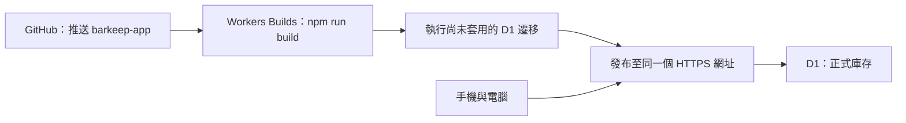

# Cloudflare 免費雲端部署與手機加到主畫面指南

BARKEEP 可使用 Cloudflare Workers Free 與 D1 免費額度。完成一次 GitHub 連結後，推送指定分支會自動建置和部署，日常使用只需要手機或電腦連上網路。使用免費額度時，以帳戶顯示的配額與 Cloudflare 當期限制為準。

## 1. 先建立 D1 資料庫

| 畫面 | 設定 |
| --- | --- |
| Cloudflare Dashboard → **Storage & databases** → **D1 SQL Database** | 選擇 **Create database** |
| **Database name** | 填寫 `barkeep`，若用不同名稱也請同步修改 `wrangler.toml` 的 `database_name` |
| 建立完成的資料庫詳情 | 複製 **Database ID**。格式為 `xxxxxxxx-xxxx-xxxx-xxxx-xxxxxxxxxxxx` |

建置時會用這個 ID 綁定 `DB`。資料表由後續的部署指令建立。若已有另一個 BARKEEP 站點，請在舊站的「系統設定」先下載完整備份，供新站還原。

[Cloudflare D1 建立與綁定文件](https://developers.cloudflare.com/d1/get-started/)

## 2. 建立 Worker 和正式庫存密碼

1. 到 **Workers & Pages** 選擇 **Create application**，建立 Worker。可先選擇 **Start with Hello World**。
2. Worker 名稱使用 `barkeep`，與根目錄 `wrangler.toml` 的 `name` 一致。確認 Dashboard 底下顯示該 Worker 的 `workers.dev` HTTPS 網址。需要其他名稱時，請同步修改 `wrangler.toml` 後再連結分支。
3. 在該 Worker 的 **Settings → Variables and Secrets** 增加下列執行期設定。密碼和搜尋金鑰都選 **Secret**，儲存後依畫面提示部署或套用。

| 名稱 | 類型 | 用途 |
| --- | --- | --- |
| `BAR_PASSWORD` | Secret，必填 | 吧台工作區密碼。建議用密碼管理器產生長度至少 16 字元的密碼 |
| `SESSION_SECRET` | Secret，建議設定 | 另一組隨機值，供登入憑證簽署。可用密碼管理器產生至少 32 字元 |
| `BRAVE_SEARCH_API_KEY` | Secret，選填 | 已登入的推薦進酒查詢優先使用 Brave Search。留白時使用中文維基百科 |

密碼會在 HTTPS 下載入有效期 30 天的登入 Cookie。更換 `BAR_PASSWORD` 或 `SESSION_SECRET` 會讓各裝置的現有登入失效；「系統設定」的登出則只撤銷該裝置的目前登入。未填密碼時，部署到 `workers.dev` 的版本會暫停正式庫存存取。

[Cloudflare Worker Secrets 文件](https://developers.cloudflare.com/workers/configuration/secrets/)

## 3. 連結 GitHub 並啟用自動部署

在該 Worker 中開啟 **Settings → Builds**，連結 GitHub 並允許 Cloudflare 存取 `zone1059123/bar_contorler`。只授權這個儲存庫即可。選擇 Workers 的 Git 整合，這個專案的後端會使用 Workers 執行。

| Builds 欄位 | 輸入內容 |
| --- | --- |
| Git provider | GitHub |
| Repository | `zone1059123/bar_contorler` |
| Production branch | `barkeep-app` |
| Root directory | 儲存庫根目錄。使用預設值或填 `/` |
| Build command | `npm run build` |
| Deploy command | `npm run deploy` |
| Build variables and secrets | 新增 `D1_DATABASE_ID`，值為第一步複製的 UUID |
| API token | 使用具有 **D1 Edit** 與 **Workers Scripts Edit** 的建置用權杖 |
| Node.js | 若帳戶的建置映像低於 Node.js 22.13，在建置變數加上 `NODE_VERSION=24` |

**建置權杖需要 D1 權限。** Workers Builds 預設產生的權杖沒有 D1 Edit。請在 Cloudflare **My Profile → API Tokens** 找到該建置權杖，編輯並加入 **Account → D1 → Edit**，或者建立可供 Builds 選用的使用者權杖。自建時可採用 **Edit Cloudflare Workers** 範本再加上 D1 Edit，帳戶資源限於部署所用的 Cloudflare 帳戶。回 Worker 的 Builds 選用該權杖，讓部署指令可以套用資料庫遷移。請將權杖留在 Cloudflare 的建置設定。

`D1_DATABASE_ID` 屬於 **Builds 的建置變數**。登入 Secret 屬於 **Worker 執行期變數**。Cloudflare 在建置時安裝鎖定版本的套件，`npm run build` 產生前端與 Worker。部署指令接著套用 D1 遷移，再發布 Worker。自動建置應選目標分支 `barkeep-app`；若介面提供 Preview builds 或非正式分支自動部署，關閉它以維持單一正式部署觸發分支。若使用不同帳戶，請使用自己的 GitHub fork 與對應分支。

[Workers Builds Git 整合](https://developers.cloudflare.com/workers/ci-cd/builds/git-integration/) · [建置與部署設定](https://developers.cloudflare.com/workers/ci-cd/builds/configuration/)

## 4. 確認資料庫與正式網址

1. 到 Worker 的 **Deployments** 或 **Builds** 查看第一次部署。若剛連結 GitHub 而尚未觸發，對 `barkeep-app` 推送一筆提交。
2. 成功的日誌會先出現 `wrangler d1 migrations apply DB --remote` 的結果，再出現 Worker 部署網址。之後的推送只套用尚未執行的 SQL。
3. 在 Worker **Bindings** 核對 D1 綁定名稱為 `DB`，資料庫為上面建立的 `barkeep`。到 D1 的 **Tables** 可看到 `items`、`inventory_events`、`sales` 等資料表。
4. 用 HTTPS 網址開啟首頁，輸入剛設定的工作區密碼。新資料庫第一次會是空的。若從舊站搬遷，在「系統設定 → 從備份檔還原」上傳原本的 JSON 或 Excel 完整備份，核對預覽筆數並確認。
5. 用第二個裝置開啟相同的 HTTPS 網址，登入正式庫存。第一個裝置儲存後，第二個裝置切回畫面會重新同步，停留在網頁時約每 20 秒檢查一次。正在填寫盤點表單時先保留畫面；若儲存時另一台裝置已更新，會提示重新核對。

根目錄 `wrangler.toml` 也能由維護者用 CLI 部署。完成 Wrangler 登入後，可在檔案填入 D1 ID，或提供建置環境變數 `D1_DATABASE_ID`，再執行 `npm ci`、`npm run build`、`npm run deploy`。日常使用或 GitHub 自動部署時不需啟動本機伺服器。

[Cloudflare D1 遷移文件](https://developers.cloudflare.com/d1/reference/migrations/) · [Workers 免費方案限制](https://developers.cloudflare.com/workers/platform/limits/)

## 5. 手機加到主畫面

| 裝置 | 操作路徑 |
| --- | --- |
| iPhone / iPad | Safari 開啟正式 HTTPS 網址 → **分享** → **加入主畫面** → 若看到「以 Web App 開啟」就啟用 → **加入** |
| Android | Chrome 開啟正式 HTTPS 網址 → 右上 **⋮** → **加到主畫面** 或 **安裝應用程式** → **加入／安裝** |

從主畫面點選 BARKEEP 圖示，直接輸入工作區密碼。部分 iPhone 或 Android 版本會把主畫面 Web App 當作另一個瀏覽工作階段，第一次從圖示開啟時可能需要再登入一次。日後可在登入有效期內直接開啟，清除網站資料或手動登出後需再登入。盤點、還原與同步需連線。

[iPhone 將網站加入主畫面](https://support.apple.com/guide/iphone/bookmark-a-website-iph42ab2f3a7/ios) · [Chrome 安裝網頁應用程式](https://support.google.com/chrome/answer/9658361)

## 備份與常見問題

- **備份與還原**：到「系統設定」下載完整 JSON 或 Excel。Excel 的「BARKEEP 還原資料」工作表需保持原樣。兩種備份都保存品項、庫存事件、叫貨草稿和營收資料。網頁還原支援解開後 16 MB 以內的備份。登入憑證和歷史操作識別碼由各站點自行管理。
- **清空正式庫存**：先下載備份，再到「系統設定」輸入畫面上的確認文字。清空與還原以資料庫交易完成。一般盤點、調撥、到貨等操作可用上方「撤銷」處理最新一筆；清空與還原則透過備份復原。
- **部署了但無法進入正式庫存**：先檢查 `BAR_PASSWORD` 是否加入 Worker 執行期的 Secret，並套用到目前部署。若登入畫面顯示服務暫時不可用，到 **Builds** 核對遷移有無成功。若日誌顯示 D1 授權錯誤，請確認所選的建置權杖已有 D1 Edit 權限。
- **提示 D1 資料庫 ID**：檢查 Builds 中的 `D1_DATABASE_ID` 是否是第一步所建立、同一 Cloudflare 帳戶內的 UUID。
- **本機備援**：`npm run dev` 仍以 Node.js 和 SQLite 啟動開發版。本機和雲端資料庫各自持久化，可用備份檔搬遷所需的營運資料。
